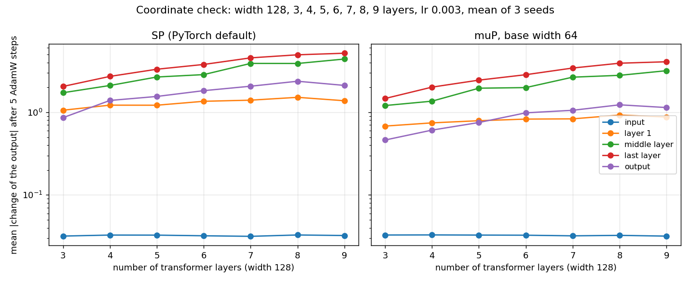
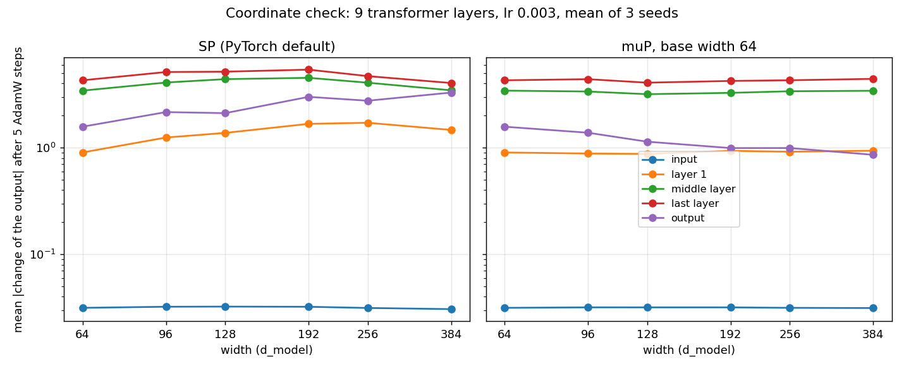

# muP: tune a small model, then train a wide one

Flags of `experiments/2026-04-27_freq-embedding/scripts/train.py`:
`--mup-base-d-model N` and `--mup-base-n-heads H`. The code is `src/mup.py`.

The Maximal Update Parametrization (muP) of Tensor Programs V (Yang and
others 2022, [arXiv 2203.03466](https://arxiv.org/abs/2203.03466)) keeps the
best learning rate of a model when its width changes. Tune the rate at a small
width, then train the wide model with the same rate.

## The base model

The base model has the flags of the run, with `--d-model N` and `H` heads
(default: `--n-heads`). It lives on the meta device, so it takes no memory and
draws no random number.

At `--d-model N`, the run is the run without muP: the PyTorch default init and
one learning rate. `tests/test_mup.py` compares the two losses CSVs line by
line.

## A run at another width

The code compares each parameter with the same parameter of the base model,
and of the delta model: the same flags at twice the base width. A dimension
scales when its size differs between these two models, or between the base
model and the run. So each tensor has the same class at each width, also at
the base width. `m` is the fan_in of the parameter divided by the fan_in of the
base parameter.

| class | parameters of the backbone | learning rate | weight decay |
|---|---|---|---|
| hidden: fan_in and fan_out scale | attention in and out projections, FFN, channel mixing `R` and `Q` | `--lr / m` | `--weight-decay * m` |
| input: fan_out scales | `encoder.proj`, `encoder.skip`, the norms, the depthwise convs, the q and k norms | `--lr` | `--weight-decay` |
| fixed: no dimension scales | the GRU patch encoder, the frequency and seasonality embeddings | `--lr` | `--weight-decay` |

The weight decay factor keeps `lr * weight_decay` of each tensor, because
`torch.optim.AdamW` decays a weight by `lr * weight_decay` at each step. The
learning rate schedule multiplies the rate of each group by its factor.

The attention logits read `sqrt(d_head0) / d_head` in place of
`1 / sqrt(d_head)`, where `d_head0` is the head size of the base model. With
the default `--mup-base-n-heads`, `d_head` scales with the width.

## The init

The init is the PyTorch default, except for the two rules below. A `Linear`
weight starts at `U(-1/sqrt(fan_in), 1/sqrt(fan_in))`, and the attention input
projection at the Xavier uniform init. For the contrastive backbone, that is
the muP init at each width. No weight maps the width to a fixed size, because
the losses read the latents by cosine. No bias follows a fan_in that scales.

The value head of the value-space objective (#415) maps the width to the
quantiles of a patch. It is an output weight, and it gets the two rules below:

- An output weight (only its fan_in scales) starts at the PyTorch init
  divided by `sqrt(m)`, and trains at `--lr / m`.
- A bias of a layer whose fan_in scales starts at the PyTorch init
  multiplied by `sqrt(m)`. So it keeps the bounds of the base layer.

## The init factors

Three flags multiply the init of the weights of one class. They are the init
multipliers of Appendix B.1 of the paper. The default is 1: the muP init.

| flag | the weights of the backbone |
|---|---|
| `--mup-init-input` | `encoder.proj`, `encoder.skip` and the depthwise convs: they map a fixed size into the width |
| `--mup-init-hidden` | the attention in and out projections, the FFN, and the channel mixing `R` and `Q` |
| `--mup-init-output` | none in the contrastive backbone: the value head of #415 |

`--mup-attn-mult` (default 1) multiplies the attention logit scale: the
multiplier `alpha_attn` of Appendix B.1. With QK-norm, it sets the temperature
of the attention at the start. Each attention layer keeps the scale in its
buffer, also at the base width.

A bias, a norm, the GRU and the embeddings keep their init. The EMA teacher
gets the same factors, so it starts equal to the student. Tune a factor at the
base width with the learning rate, then keep it at the larger width. The run
prints the factors and the count of tensors of each class.

## The depth rule

muP sets the rules of the width. The depth rule sets the rules of the count
of layers of a stack: Table 1 of CompleteP (Dey and others 2025,
[arXiv 2505.01618](https://arxiv.org/abs/2505.01618)), after the Depth-muP of
Tensor Programs VI (Yang and others 2023,
[arXiv 2310.02244](https://arxiv.org/abs/2310.02244)).

| flag | default | effect |
|---|---|---|
| `--mup-base-num-layers` | `--num-layers` | the base count of forecaster layers |
| `--mup-base-num-encoder-layers` | `--num-encoder-layers` | the base count of encoder layers, also for the EMA teacher |
| `--mup-depth-alpha` | 1 | alpha in [0.5, 1] |

With `m_L` the count of layers of a stack over its base count:

- Each layer of the stack multiplies the output of its attention branch and
  of its FFN branch by `m_L^(-alpha)` before the residual add. The layer keeps
  the factor in the buffer `residual_branch_scale` of the checkpoint, as the
  attention logit scale.
- Each parameter of the layers of the stack trains at `lr * m_L^(alpha - 1)`.
  The weight decay keeps its width factor only.

`alpha 1` is CompleteP: the learning rates do not change, only the branches.
`alpha 0.5` is the Depth-muP of Tensor Programs VI. CompleteP reports that
only `alpha 1` keeps the best learning rate and init across depth for pre-norm
transformers (their Finding 2). The layers of this trainer are pre-norm. At
the base depth every factor is 1.

AdamW `eps` stays at 1e-8. Table 1 of CompleteP also scales it, and its
footnote 3 finds that a small enough `eps` keeps the transfer.

The rollout of the forecaster (`--train-rollout-depth`) applies the same
layers again. The depth rule counts the layers of the stack, not the rollout
steps.

## The checkpoint

At a width other than the base, each attention layer keeps its scale in the
buffer `attn_logit_scale`. A loader of the checkpoint gets the scale back, so
the head trainer and the evaluation need no flag. A loader with older code
stops on the unknown key. A run at the base width, and a run without muP, keep
the keys of earlier checkpoints.

## Limits

- A GRU keeps its size: its init follows its hidden size. The code stops on a
  recurrent layer that scales.
- An attention layer whose `d_head` changes needs `--qk-norm`, because the
  scale goes to `scaled_dot_product_attention`.
- The forecast heads have no muP. They train on the frozen latent at their own
  rate.
- Weight decay and dropout do not transfer (Table 1 of the paper).

## Example

```bash
# Tune --lr at the base width: 64 with 8 heads, so d_head is 8.
python3 experiments/2026-04-27_freq-embedding/scripts/train.py <flags> \
  --d-model 64 --n-heads 8 --qk-norm --mup-base-d-model 64 --lr 1e-3

# The same flags at 384 (d_head 48) with the tuned rate.
python3 experiments/2026-04-27_freq-embedding/scripts/train.py <flags> \
  --d-model 384 --n-heads 8 --qk-norm --mup-base-d-model 64 --lr 1e-3

# An init factor, tuned at the base width, then kept at 384.
python3 experiments/2026-04-27_freq-embedding/scripts/train.py <flags> \
  --d-model 384 --n-heads 8 --qk-norm --mup-base-d-model 64 --lr 1e-3 \
  --mup-init-hidden 0.5
```

## Coordinate check

```bash
python3 scripts/mup_coord_check.py --out docs/mup_coord_check.png
```


Three transformer layers of the trainer, between an input layer and an output
layer, train 5 AdamW steps on random data at widths 64 to 512, in the
standard parametrization and in muP. The figure shows the mean change of the
output of each layer. In the standard parametrization, the change of the
transformer layers grows with the width. In muP it keeps its size.

```bash
python3 scripts/mup_coord_check.py --vary depth --out docs/mup_coord_check_depth.png
```



The same check at the width 128, from 3 to 9 transformer layers, with the
muP base width 64. In the standard parametrization and in muP, the change of
the last layer grows by about 2.5 times from 3 to 9 layers. With the depth
rule (`alpha 1`, base depth 3), the change of the last layer stays at 1.5,
and the change of the first layer falls as `1 / L`: each layer adds `1 / L`
of the change, and their sum keeps its size.

```bash
python3 scripts/mup_coord_check.py --layers 9 --widths 64,96,128,192,256,384 \
  --out docs/mup_coord_check_9layers.png
```



The width check at 9 transformer layers, from the width 64 to 384. In muP the
change of the first, middle and last layer keeps its size. In the standard
parametrization the change of the first layer at 192 to 384 is 1.6 to 1.9
times its change at 64.
