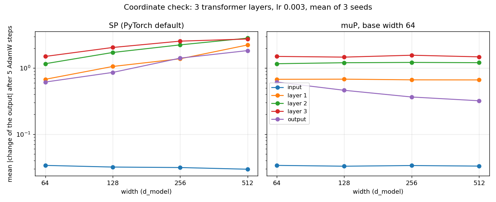

# muP: tune a small model, then train a wide one

Flags of `experiments/2026-04-27_freq-embedding/scripts/train.py`:
`--mup-base-d-model N` and `--mup-base-n-heads H`. The code is `src/mup.py`.

The Maximal Update Parametrization (muP) of Tensor Programs V (Yang and
others 2022, [arXiv 2203.03466](https://arxiv.org/abs/2203.03466)) keeps the
best learning rate of a model when its width changes. Tune the rate at a small
width, then train the wide model with the same rate.

## The base model

The base model has the flags of the run, with `--d-model N` and `H` heads
(default: `--n-heads`). It lives on the meta device, so it takes no memory and
draws no random number.

At `--d-model N`, the run is the run without muP: the PyTorch default init and
one learning rate. `tests/test_mup.py` compares the two losses CSVs line by
line.

## A run at another width

The code compares each parameter with the same parameter of the base model. A
dimension scales when its size differs. `m` is the fan_in of the parameter
divided by the fan_in of the base parameter.

| class | parameters of the backbone | learning rate | weight decay |
|---|---|---|---|
| hidden: fan_in and fan_out scale | attention in and out projections, FFN, channel mixing `R` and `Q` | `--lr / m` | `--weight-decay * m` |
| input: fan_out scales | `encoder.proj`, `encoder.skip`, the norms, the depthwise convs, the q and k norms | `--lr` | `--weight-decay` |
| fixed: no dimension scales | the GRU patch encoder, the frequency and seasonality embeddings | `--lr` | `--weight-decay` |

The weight decay factor keeps `lr * weight_decay` of each tensor, because
`torch.optim.AdamW` decays a weight by `lr * weight_decay` at each step. The
learning rate schedule multiplies the rate of each group by its factor.

The attention logits read `sqrt(d_head0) / d_head` in place of
`1 / sqrt(d_head)`, where `d_head0` is the head size of the base model. With
the default `--mup-base-n-heads`, `d_head` scales with the width.

## The init

The init is the PyTorch default, except for the two rules below. A
`Linear` weight starts at `U(-1/sqrt(fan_in), 1/sqrt(fan_in))`, and the
attention input projection at the Xavier uniform init. For the contrastive backbone, that is the muP init at
each width. No weight maps the width to a fixed size, because the losses read
the latents by cosine. No bias follows a fan_in that scales.

The value head of the value-space objective (#415) maps the width to the
quantiles of a patch. It is an output weight, and it gets the two rules below:

- An output weight (only its fan_in scales) starts at the PyTorch init
  divided by `sqrt(m)`, and trains at `--lr / m`.
- A bias of a layer whose fan_in scales starts at the PyTorch init
  multiplied by `sqrt(m)`. So it keeps the bounds of the base layer.

## The checkpoint

At a width other than the base, each attention layer keeps its scale in the
buffer `attn_logit_scale`. A loader of the checkpoint gets the scale back, so
the head trainer and the evaluation need no flag. A loader with older code
stops on the unknown key. A run at the base width, and a run without muP, keep
the keys of earlier checkpoints.

## Limits

- A GRU keeps its size: its init follows its hidden size. The code stops on a
  recurrent layer that scales.
- An attention layer whose `d_head` changes needs `--qk-norm`, because the
  scale goes to `scaled_dot_product_attention`.
- The forecast heads have no muP. They train on the frozen latent at their own
  rate.
- Weight decay and dropout do not transfer (Table 1 of the paper).

## Example

```bash
# Tune --lr at the base width: 64 with 8 heads, so d_head is 8.
python3 experiments/2026-04-27_freq-embedding/scripts/train.py <flags> \
  --d-model 64 --n-heads 8 --qk-norm --mup-base-d-model 64 --lr 1e-3

# The same flags at 384 (d_head 48) with the tuned rate.
python3 experiments/2026-04-27_freq-embedding/scripts/train.py <flags> \
  --d-model 384 --n-heads 8 --qk-norm --mup-base-d-model 64 --lr 1e-3
```

## Coordinate check

```bash
python3 scripts/mup_coord_check.py --out docs/mup_coord_check.png
```



Three transformer layers of the trainer, between an input layer and an output
layer, train 5 AdamW steps on random data at widths 64 to 512, in the
standard parametrization and in muP. The figure shows the mean change of the
output of each layer. In the standard parametrization, the change of the
transformer layers grows with the width. In muP it keeps its size.
