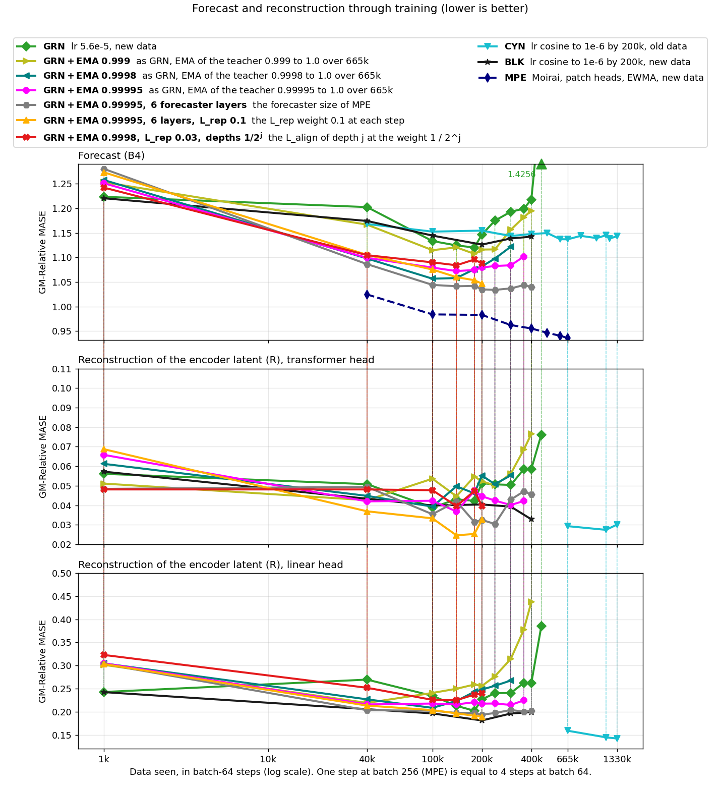
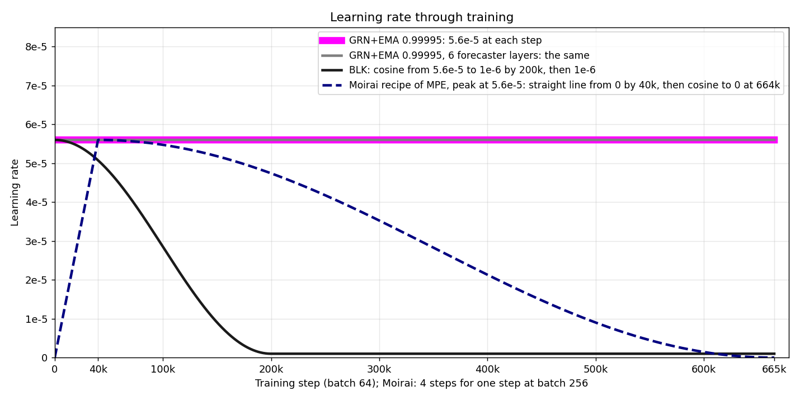
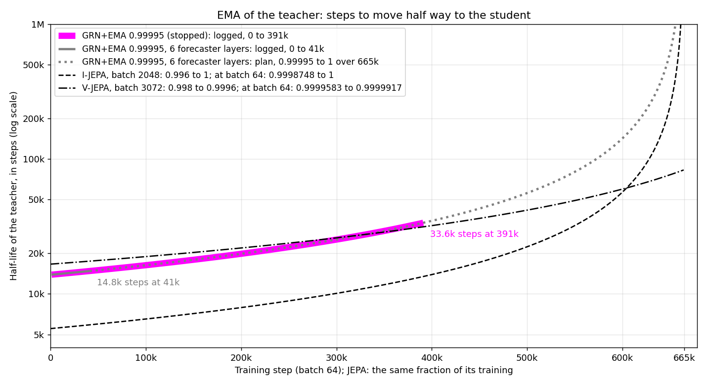
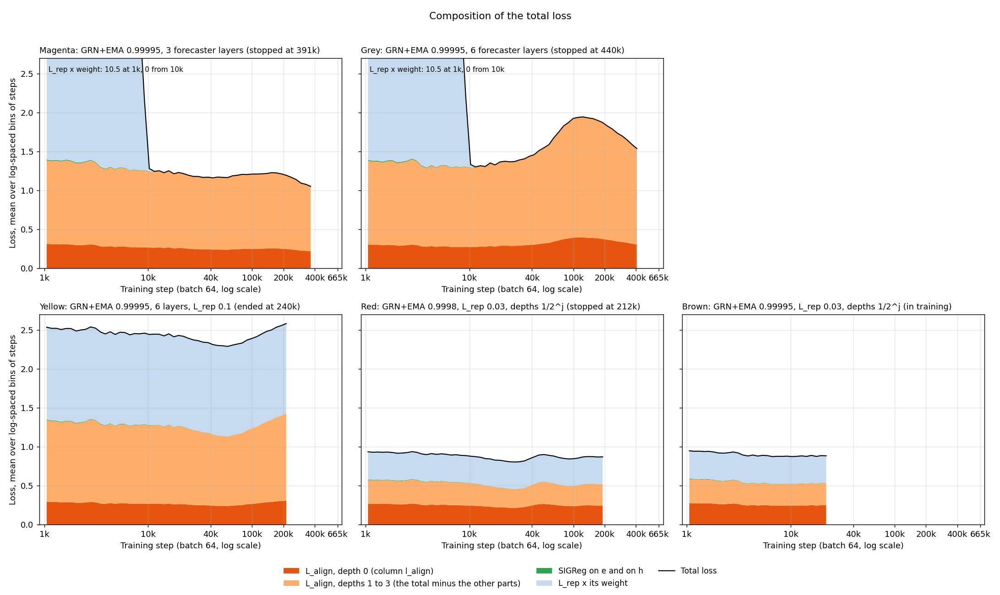
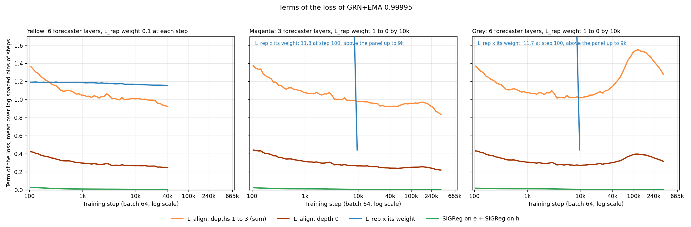

# The GRN+EMA runs through training: forecast, reconstruction and loss

## Forecast and reconstruction

Grey (EMA 0.99995, 6 forecaster layers, stopped at 440k) has the lowest forecast MASE of the GRN runs: 1.0341 at 240k.
Magenta (the same with 3 forecaster layers) has its lowest MASE, 1.0723, at 140k, and teal (EMA 0.9998) has 1.0568 at 100k.
At 200k, the forecast MASE is 1.0467 for yellow (grey with the L_rep weight 0.1 at each step), 1.0351 for grey and 1.0879 for red (EMA 0.9998, the L_rep weight 0.03 at each step).

## Learning rate

The six GRN runs keep the learning rate at 5.6e-5 at each step.
MPE (Moirai) has batch 256 and a peak of 1e-3, and the figure shows its recipe with the peak at 5.6e-5.

## EMA momentum of the teacher

The half-life of the teacher of magenta and grey is 13.9k steps at 1k and 33.6k steps at 391k.
The JEPA lines move the momentum to batch 64 with the EMA scaling rule of Busbridge and others (2023): `momentum ** (64 / batch size)`.
At batch 64, the half-life starts at 5.5k steps for I-JEPA and at 16.6k steps for V-JEPA.

## Parts of the total loss

From 11k, L_align at depths 1 to 3 is 78% to 80% of the total loss of magenta and grey.
For yellow, this part is 39% to 43% from 11k to 213k, and for red 30% to 32% from 11k to 191k.
The total loss of magenta decreases from 1.24 at 11k to 1.05 at 366k, and grey has its maximum, 1.94, at 124k.

## Loss terms

From step 100, yellow keeps L_rep x its weight between 1.15 and 1.19 up to 209k, and red between 0.35 and 0.36 up to 188k.
L_align at depths 1 to 3 is 0.89 at 56k and 1.10 at 188k for yellow, 0.93 and 0.96 for magenta, 1.25 and 1.49 for grey, and 0.28 and 0.28 for red (with its depth weights).
At the same steps, L_align at depth 0 is 0.24 and 0.30 for yellow, 0.24 and 0.25 for magenta, 0.32 and 0.38 for grey, and 0.26 and 0.24 for red.
