# The GRN+EMA runs through training: forecast, reconstruction and loss

## Forecast and reconstruction

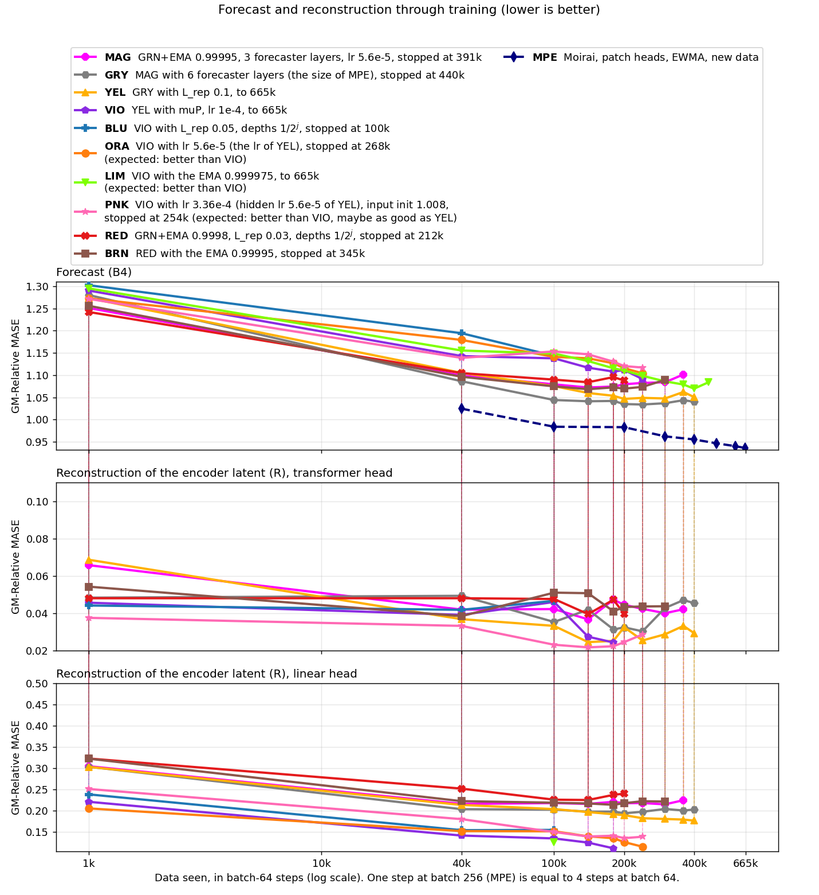

Grey (EMA 0.99995, 6 forecaster layers, stopped at 440k) has the lowest forecast MASE of the GRN runs: 1.0341 at 240k.
Magenta (the same with 3 forecaster layers) has its lowest MASE, 1.0723, at 140k.
At 200k, the forecast MASE is 1.0467 for yellow (grey with the L_rep weight 0.1 at each step), 1.0351 for grey and 1.0879 for red (EMA 0.9998, the L_rep weight 0.03 at each step, depth j of L_align at the weight 1/2^j).
DGY (dark grey) is grey from its 240k save, with the learning rate annealed from 5.6e-5 to 0 by a cosine over 48k steps (the cooldown of a WSD schedule).
Its forecast MASE at 288k is 1.0238, the lowest of the report.
Its R scores at 288k are 0.0388 (transformer head) and 0.2000 (linear head), between the scores of grey at 240k (0.0304 and 0.1973) and at 300k (0.0429 and 0.2039).
Violet has its lowest forecast MASE, 1.0779, at 460k.
At 665k, the end of its training, it gets 1.0799 (1.0977 at 600k).
Its R scores at 665k are 0.0218 (transformer head) and 0.1323 (linear head).

## Learning rate

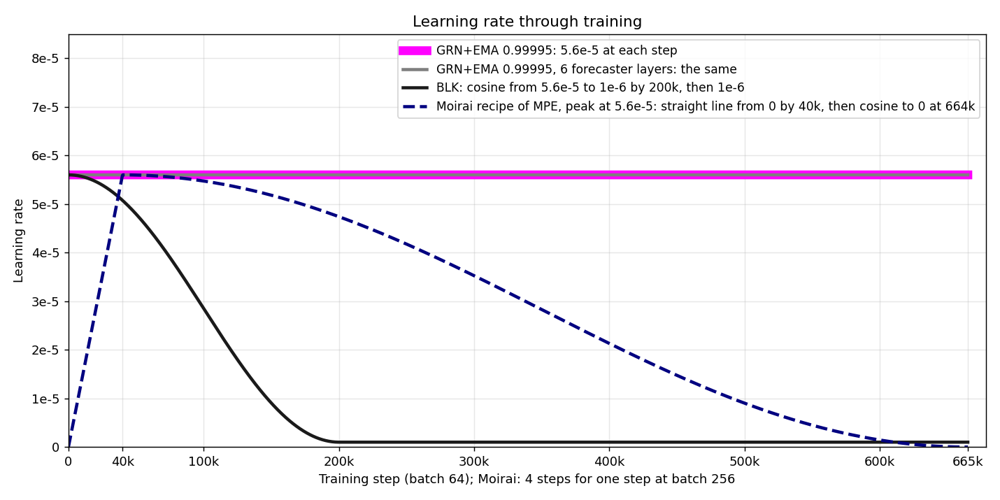

The six GRN runs keep the learning rate at 5.6e-5 at each step.
MPE (Moirai) has batch 256 and a peak of 1e-3, and the figure shows its recipe with the peak at 5.6e-5.

## EMA momentum of the teacher

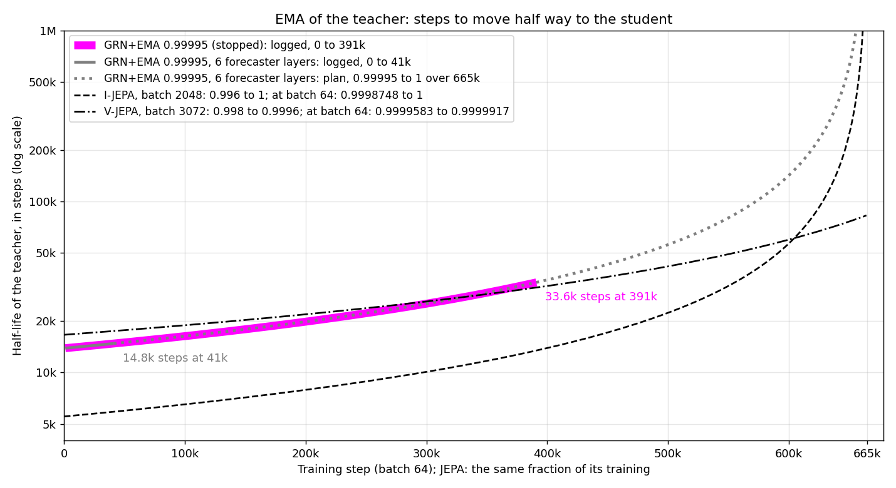

The half-life of the teacher of magenta and grey is 13.9k steps at 1k and 33.6k steps at 391k.
The JEPA lines move the momentum to batch 64 with the EMA scaling rule of Busbridge and others (2023): `momentum ** (64 / batch size)`.
At batch 64, the half-life starts at 5.5k steps for I-JEPA and at 16.6k steps for V-JEPA.

## Parts of the total loss

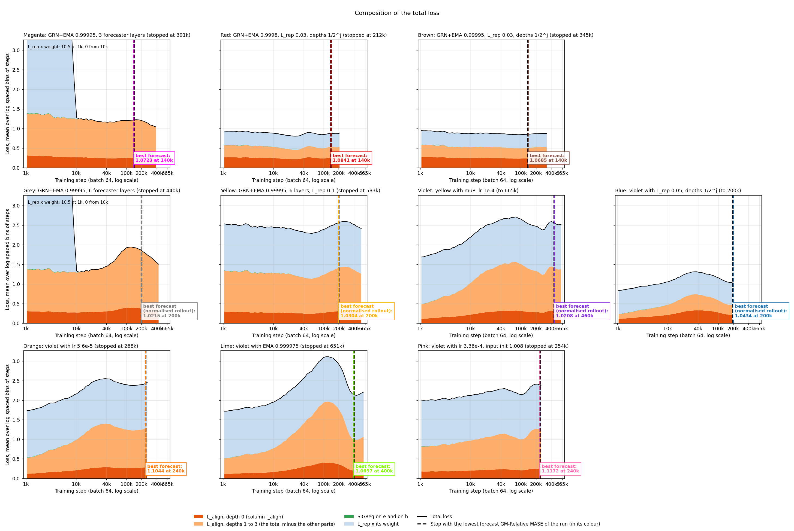

From 11k, L_align at depths 1 to 3 is 78% to 80% of the total loss of magenta and grey.
For yellow, this part is 39% to 43% from 11k to 213k, and for red 30% to 32% from 11k to 191k.
The total loss of magenta decreases from 1.24 at 11k to 1.05 at 366k, and grey has its maximum, 1.94, at 124k.

## Loss terms

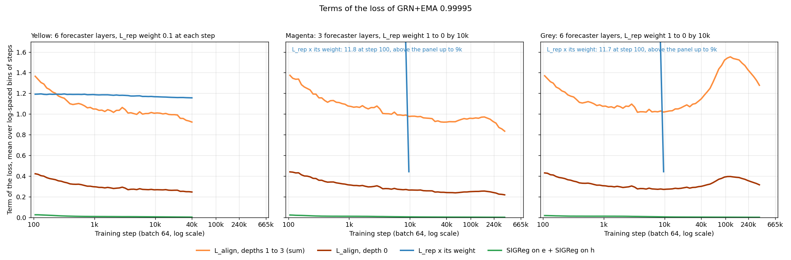

From step 100, yellow keeps L_rep x its weight between 1.15 and 1.19 up to 209k, and red between 0.35 and 0.36 up to 188k.
L_align at depths 1 to 3 is 0.89 at 56k and 1.10 at 188k for yellow, 0.93 and 0.96 for magenta, 1.25 and 1.49 for grey, and 0.28 and 0.28 for red (with its depth weights).
At the same steps, L_align at depth 0 is 0.24 and 0.30 for yellow, 0.24 and 0.25 for magenta, 0.32 and 0.38 for grey, and 0.26 and 0.24 for red.

## Hyperparameter search

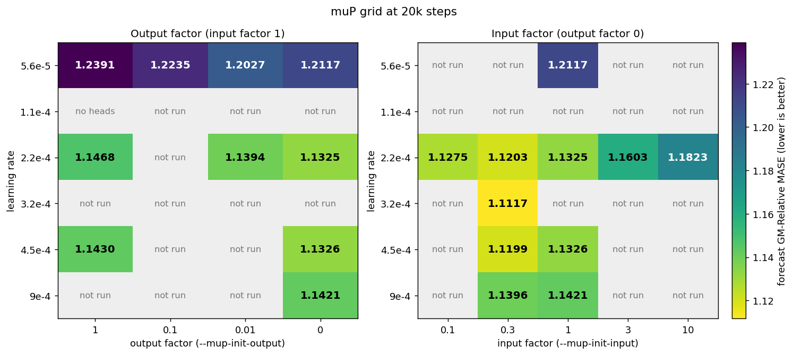

Each cell is one run of 20k steps at width 64, with 3 encoder and 3 forecaster layers and the same seed.
The factors scale the init of the last layer's output weights (output factor) and of the patch encoder projections (input factor).
The best cell is lr 3.2e-4 with the output factor 0 and the input factor 0.3.

## The 40k grid and its second round

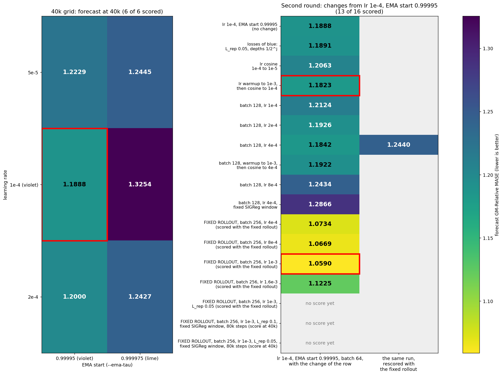

Each cell is one run of 40k steps at width 64, with 1 encoder layer, 3 forecaster layers, the flags of violet and the same seed.
The EMA momentum goes to 1.0 over the 40k steps.
Of the 6 cells, lr 1e-4 with the EMA start 0.99995 (the settings of violet) has the lowest score, 1.1888.
The EMA start 0.99995 is better than 0.999975 at each learning rate.
The second round starts from lr 1e-4 with the EMA start 0.99995.
A warmup of the learning rate to 1e-3 over 4k steps, then a cosine to 1e-4, gives 1.1823, the lowest score.
The losses of blue give 1.1891, and a cosine from 1e-4 to 1e-5 gives 1.2063.
At batch 128, the learning rates 1e-4, 2e-4 and 4e-4 give 1.2124, 1.1926 and 1.1842.
The score decreases up to 4e-4, the highest learning rate of the search.
At batch 128, a warmup to 1e-3 over 4k steps, then a cosine to 4e-4, gives 1.1922.
The constant learning rate 4e-4 gives 1.1842.

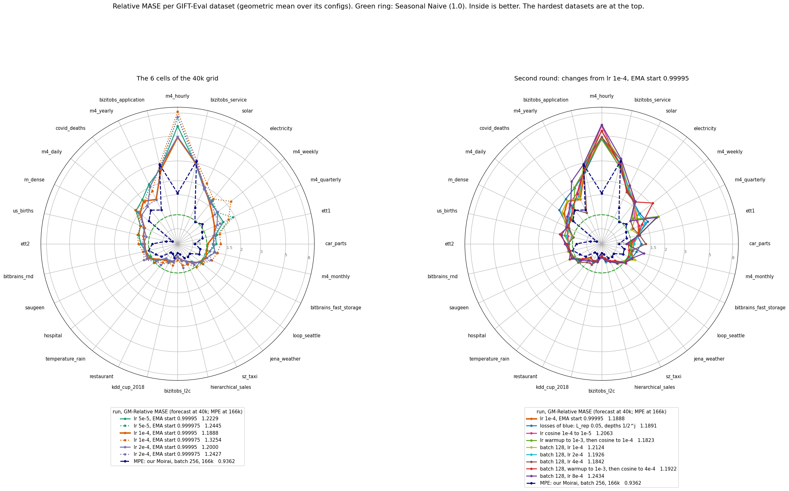

The radars give the relative MASE of each GIFT-Eval dataset, the geometric mean over its configs.
19 of the 28 datasets stay above 1 in each of the 6 cells.
The largest gaps to MPE are m4_hourly (4.87 for lr 1e-4 with the EMA start 0.99995, 1.55 for MPE), electricity (1.58 and 0.97) and solar (1.97 and 1.25).

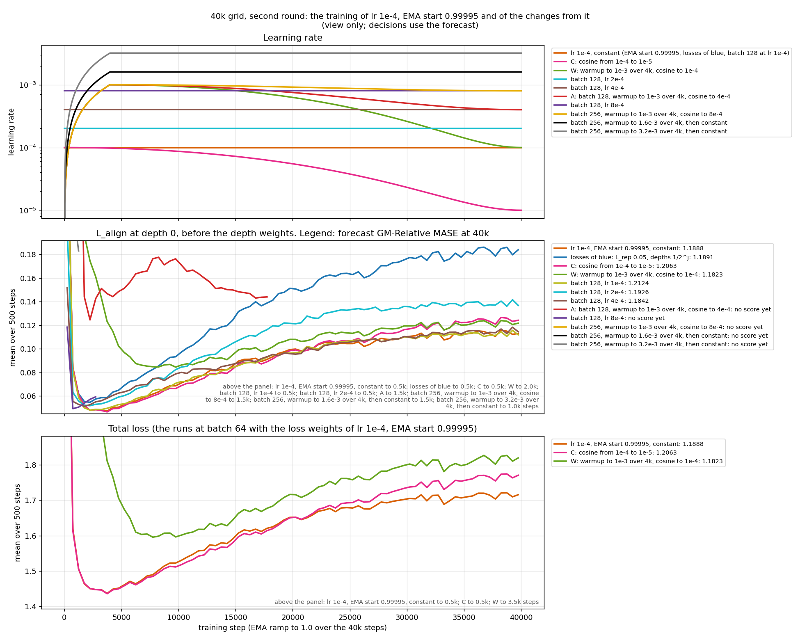

This figure shows the learning rate and the training losses of the second round.
The decisions use the forecast MASE only.

## Forecast by horizon

| GM-Relative MASE | DGY, 288k | MPE, 166k | Moirai small 1.1-R |
|---|---|---|---|
| short horizon, 55 configs | 0.860 | 0.850 | 0.888 |
| medium horizon, 21 configs | 1.299 | 1.052 | 1.022 |
| long horizon, 21 configs | 1.273 | 1.075 | 1.035 |

At the short horizon, DGY is as good as MPE.
The gap to MPE is at the medium and long horizons, 10 and 15 times the short horizon.

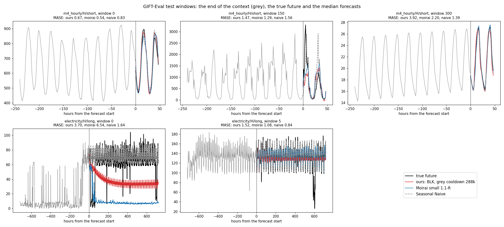

On m4_hourly (48 hours), DGY and Moirai small both follow the daily cycle.
On electricity/H/long (720 hours), the median of DGY loses the daily cycle after the first patches, and Moirai small keeps it in window 5.

## Two kinds of collapse

The two figures come from session think-contrastive (scripts `latent_spectrum.py`, `plot_rank_vs_score.py`, `rollout_spread.py`, `plot_rollout_spread.py` and `causality_check.py`, which run on elisa from `/home/jupyter/cf_runs/qkgain_test`).

### Over long training

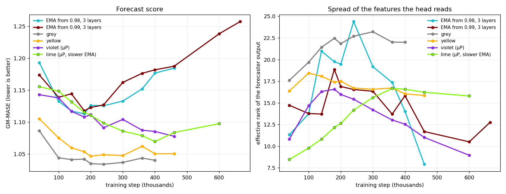

The effective rank is the exponential of the entropy of the normalised eigenvalues of the covariance of the forecaster output `f`, the features that the forecast head reads.
It comes from 62 real GIFT-Eval windows of 8 sources, the last 32 patches of each (`results/results_latent_spectrum_stops.tsv`).
In the run with the EMA from 0.98, the rank of `f` falls from 24.4 at 240k to 7.9 at 460k, and its forecast MASE rises by 0.072 from its best stop.
At 460k, the top direction holds 66% of the variance of `h` (13% at 240k).
In the run with the EMA from 0.99, the rank falls from 18.9 at 180k to between 10.5 and 12.8 from 460k, and its forecast MASE rises by 0.139 by 665k.
Grey and yellow keep a flat rank.
The rank of violet falls from 16.6 at 180k to 8.9 at 600k.
SIGReg did not see this collapse: its integration window was too narrow (PR #438 fixes it).

### Over a long forecast

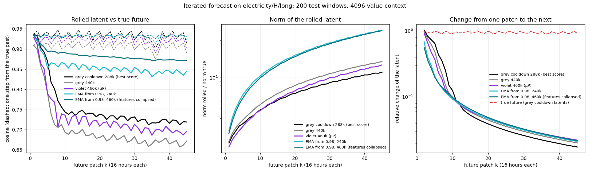

On electricity/H/long (45 future patches, 200 test windows, a context of 4096 values), the rolled latent of DGY has a cosine of 0.94 with the latent of the true future at patch 1, 0.74 at patch 10 and 0.72 at patch 45.
The one-step prediction from the true past stays between 0.91 and 0.94.
The change of the rolled latent from one patch to the next falls from 0.83 at patch 3 to 0.018 at patch 45, and the true future changes by about 0.93.
The norm of the rolled latent grows to 11.7 times the norm of the true latent.
So after about 10 patches the forecast stays on one latent, and the head decodes the same 16 values at each patch.
The five models show the same pattern (`results/results_rollout_c4096.tsv`, `results/results_rollout_c1024.tsv`, `results/results_rollout_m4.tsv`).
The rollout gives the raw forecaster output back to the forecaster, and L_align (a cosine) does not train the norm of `f`.

## Caveats of the forecast scores

Each forecast score of this report comes from the eval of this time:

- The official eval gives the backbone 1024 context values. The backbones trained on 4096.
- The forecast head trains on `f` only, and B4 decodes the encoder latent of the context and the rolled `f`.
- The rollout gives the raw forecaster output back to the forecaster.

Session think-contrastive fixes the second and the third point (#443, #446 and #447).
With the normalised rollout of #446, grey at 400k gets 1.0331 with 1024 context values and 1.0555 with 4096 values.
So the eval keeps 1024 values (#449).
