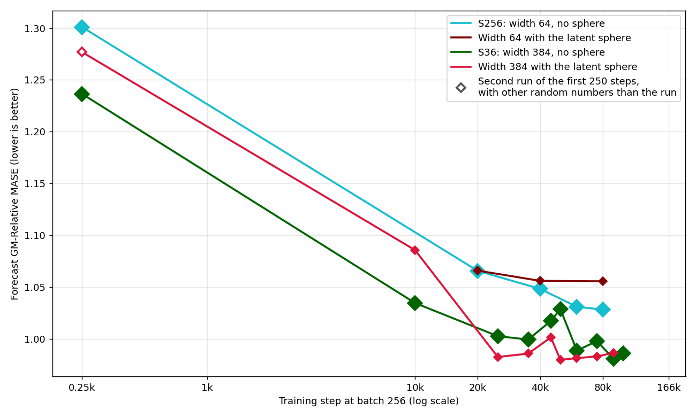

# The GRN+EMA runs through training: forecast, reconstruction and loss

## Forecast and reconstruction

Grey (EMA 0.99995, 6 forecaster layers, stopped at 440k) has the lowest forecast MASE of the GRN runs: 1.0341 at 240k.
Magenta (the same with 3 forecaster layers) has its lowest MASE, 1.0723, at 140k.
Magenta, teal (magenta with the EMA 0.9998), TRQ (teal with the SIGReg window fix) and red are out of this figure, on the request of the user.
At 200k, the forecast MASE is 1.0467 for yellow (grey with the L_rep weight 0.1 at each step), 1.0351 for grey and 1.0879 for red (EMA 0.9998, the L_rep weight 0.03 at each step, depth j of L_align at the weight 1/2^j).
DGY (dark grey) is grey from its 240k save, with the learning rate annealed from 5.6e-5 to 0 by a cosine over 48k steps (the cooldown of a WSD schedule).
Its forecast MASE at 288k is 1.0238, the lowest of the report.
Its R scores at 288k are 0.0388 (transformer head) and 0.2000 (linear head), between the scores of grey at 240k (0.0304 and 0.1973) and at 300k (0.0429 and 0.2039).
Violet has its lowest forecast MASE, 1.0779, at 460k.
At 665k, the end of its training, it gets 1.0799 (1.0977 at 600k).
Its R scores at 665k are 0.0218 (transformer head) and 0.1323 (linear head).
Blue (violet with the L_rep weight 0.05 and the depth weights 1/2^j) gets 1.0693 at 140k with the normalised rollout of #446.
At 100k, it gets 1.1190 with the normalised rollout and 1.1435 with the raw rollout.
At 140k, with the raw rollout, grey gets 1.0414, yellow 1.0600 and violet 1.1169.
At 180k, blue gets 1.0482 with the normalised rollout.
At 200k, blue gets 1.0434 with the normalised rollout, its lowest score.
At 240k, blue gets 1.0512 (grey 1.0269, yellow 1.0257, violet 1.0614, all with the normalised rollout).
At 300k, blue gets 1.0504 (grey 1.0008, yellow 1.0245, violet 1.0684, all with the normalised rollout).
At 360k, blue gets 1.0848 (grey 1.0279, yellow 1.0330, violet 1.0606, all with the normalised rollout).
At 180k, with the raw rollout, grey gets 1.0421 and yellow 1.0537.
A light grey disc behind a point marks a bugged score, with the raw rollout.
The forecast panel also shows one run of the 40k grid at the data it saw, S256: width 64, 1 encoder and 3 forecaster layers, batch 256, lr 1e-3, L_rep 0.1.
The heatmap compares it with the other runs of the grid.
With the SIGReg target at a latent norm of about √64 = 8, S256 gets 1.3010 after 250 steps of batch 256 (1k on the axis), 1.0656 at 20k, 1.0481 at 40k steps of batch 256 (160k on the axis), 1.0309 at 60k (240k on the axis) and 1.0281 at 80k (320k on the axis).
S36 is S256 at width 384 with muP: 3 encoder and 6 forecaster layers, the SIGReg target at a latent norm of about √384 = 19.6, and 166k steps of batch 256 with the EMA ramp over the 166k steps.
It gets 1.2365 after 250 steps (1k on the axis) and 1.0345 at 10k (40k on the axis).
At 10k, its short, medium and long scores are 0.9384, 1.1893 and 1.1616, and MPE gets 1.0247.
The scores after 250 steps come from a second run of the first 250 steps of S256 and of S36, with the same flags and seed: in each, the losses of steps 1 to 200 are equal to the losses of the run.
With the normalised rollout, the best stops of grey (1.0269 at 240k), yellow (1.0304 at 200k) and violet (1.0208 at 460k) are below blue at 180k (1.0482).
Grey at 200k gets 1.0215 with the normalised rollout, its lowest score.

## Learning rate

The six GRN runs keep the learning rate at 5.6e-5 at each step.
MPE (Moirai) has batch 256 and a peak of 1e-3, and the figure shows its recipe with the peak at 5.6e-5.

## EMA momentum of the teacher

The half-life of the teacher of magenta and grey is 13.9k steps at 1k and 33.6k steps at 391k.
The JEPA lines move the momentum to batch 64 with the EMA scaling rule of Busbridge and others (2023): `momentum ** (64 / batch size)`.
At batch 64, the half-life starts at 5.5k steps for I-JEPA and at 16.6k steps for V-JEPA.

## Parts of the total loss

From 11k, L_align at depths 1 to 3 is 78% to 80% of the total loss of magenta and grey.
For yellow, this part is 39% to 43% from 11k to 213k, and for red 30% to 32% from 11k to 191k.
The total loss of magenta decreases from 1.24 at 11k to 1.05 at 366k, and grey has its maximum, 1.94, at 124k.

## Loss terms

From step 100, yellow keeps L_rep x its weight between 1.15 and 1.19 up to 209k, and red between 0.35 and 0.36 up to 188k.
L_align at depths 1 to 3 is 0.89 at 56k and 1.10 at 188k for yellow, 0.93 and 0.96 for magenta, 1.25 and 1.49 for grey, and 0.28 and 0.28 for red (with its depth weights).
At the same steps, L_align at depth 0 is 0.24 and 0.30 for yellow, 0.24 and 0.25 for magenta, 0.32 and 0.38 for grey, and 0.26 and 0.24 for red.

## Hyperparameter search

Each cell is one run of 20k steps at width 64, with 3 encoder and 3 forecaster layers and the same seed.
The factors scale the init of the last layer's output weights (output factor) and of the patch encoder projections (input factor).
The best cell is lr 3.2e-4 with the output factor 0 and the input factor 0.3.

## The 40k grid and its second round

Each cell is one run of 40k steps at width 64, with 1 encoder layer, 3 forecaster layers, the flags of violet and the same seed.
The EMA momentum goes to 1.0 over the 40k steps.
Of the 6 cells, lr 1e-4 with the EMA start 0.99995 (the settings of violet) has the lowest score, 1.1888.
The EMA start 0.99995 is better than 0.999975 at each learning rate.
The second round starts from lr 1e-4 with the EMA start 0.99995.
A warmup of the learning rate to 1e-3 over 4k steps, then a cosine to 1e-4, gives 1.1823, the lowest score.
The losses of blue give 1.1891, and a cosine from 1e-4 to 1e-5 gives 1.2063.
At batch 128, the learning rates 1e-4, 2e-4, 4e-4 and 8e-4 give 1.2124, 1.1926, 1.1842 and 1.2434.
The lowest score is at 4e-4.
At batch 128, a warmup to 1e-3 over 4k steps, then a cosine to 4e-4, gives 1.1922.
The constant learning rate 4e-4 gives 1.1842.
The same run with the SIGReg window fix of #438 gives 1.2866.
In this run, SIGReg is about 16.4 from step 200 to 35.5k, 100 to 300 times L_align.
Between 35.5k and 36.5k, SIGReg falls to about 0.2.
The batch-256 runs keep the old SIGReg window.
They train with the normalised rollout feedback of #447, and their scores use the normalised rollout of #446.
At batch 256, the constant learning rates 4e-4, 8e-4, 1e-3 and 1.6e-3 give 1.0734, 1.0669, 1.0590 and 1.1225.
The lowest score is at 1e-3.
Compared with 8e-4, the score at 1e-3 is lower on the medium and long horizons (1.1605 and 1.1546 against 1.1852 and 1.1728).
At 1e-3, L_rep 0.05 gets 1.0936 at 40k (short 1.0114, medium 1.2092, long 1.2137), above L_rep 0.1 (1.0590).
Two runs at 1e-3 train now for 80k steps with the SIGReg window fix, with L_rep 0.1 and 0.05.
With the SIGReg window fix, SIGReg stays at about 8.2 per term on the latents of plain muP.
Each coordinate of a latent stays at about 1, so a latent has a norm of about √64 = 8.
The target of SIGReg is a variance of 1/64 per coordinate.
A start of the patch encoder near zero (`--mup-init-input 0.01`) and a linear ramp of the learning rate over 1k steps did not lower SIGReg.
The 80k runs now train with `--sigreg-latent-scale inv_sqrt_d`: the SIGReg target becomes a latent norm of about √64 = 8.
Only SIGReg changes: the model uses the latents as they are, and it stays plain muP.
In a test of 300 steps, SIGReg on the encoder output falls from 9.4 to 0.09 with this factor.
At 20k, the 80k run with L_rep 0.1 gets 1.0656 (short 0.9844, medium 1.1831, long 1.1811).
At 40k, it gets 1.0481 (short 0.9741, medium 1.1572, long 1.1500), the lowest score of the grid.
At 60k, it gets 1.0309 (short 0.9356, medium 1.1576, long 1.1836).
At 80k, it gets 1.0281 (short 0.9584, medium 1.1303, long 1.1238), in the right column of the heatmap.
With L_rep 0.05, the other 80k run gets 1.0770 at 40k (short 0.9769, medium 1.2063, long 1.2416).
At 80k, it gets 1.0347 (short 0.9351, medium 1.1755, long 1.1874), 0.0066 above the run with L_rep 0.1.
Its short score is lower: 0.9351 against 0.9584.
A third 80k run adds `--latent-sphere` to the L_rep 0.1 run (contrastive-forecasting #453): e, h and f go on one sphere of radius 8 after SIGReg.
In training, the encoder reads e on the sphere.
The first heads of this run read the encoder output of the raw e: contrastive-forecasting #454 puts e on the sphere in the head path too.
With the fixed head path, the run gets 1.0658 at 20k (short 0.9884, medium 1.1807, long 1.1724), 0.0002 above the run without the sphere.
At 40k, it gets 1.0559 (short 0.9508, medium 1.2049, long 1.2175), 0.0078 above the run without the sphere (1.0481).
With the sphere, the short score is lower (0.9508 against 0.9741), and the medium and long scores are higher (1.2049 against 1.1572, 1.2175 against 1.1500).
With the old head path, it got 1.0691 at 20k and 1.0610 at 40k.
The heatmap row gives the 40k score of the fixed head path.

The figure compares the runs with the latent sphere and the same runs without it, at batch 256, with the scores of the fixed head path only: width 64 to 80k steps, and width 384 (S36) to 166k steps.
The sphere run of width 384 gets 1.2769 after 250 steps, and S36 gets 1.2365.
This point of the sphere run comes from a second run of its first 250 steps on elisa, with torch 2.8.0.
The run trained on the box with torch 2.9.1, and the losses already differ at step 1 (55.33 and 55.42), so an open marker shows the point.
The heatmap has its row.
With the fixed rollout, batch 128 at 4e-4 gets 1.2440, and 1.1842 with the raw rollout (the middle column).
This run trained with the raw rollout feedback.
At 40k, the fixed rollout also gives higher scores for violet (1.1948 against 1.1430) and blue (1.2337 against 1.1944), the two muP runs with the flags of the grid.
The other scores of the grid use the raw rollout feedback, so compare a batch-256 score only with the other batch-256 scores.
The largest change is on m4_hourly: 2.29 for batch 256 at 8e-4, 4.89 for batch 128 at 4e-4 and 1.55 for MPE.

The radars give the relative MASE of each GIFT-Eval dataset, the geometric mean over its configs.
19 of the 28 datasets stay above 1 in each of the 6 cells.
The largest gaps to MPE are m4_hourly (4.87 for lr 1e-4 with the EMA start 0.99995, 1.55 for MPE), electricity (1.58 and 0.97) and solar (1.97 and 1.25).

This figure shows the learning rate and the training losses of the second round.
The decisions use the forecast MASE only.

## Forecast by horizon

| GM-Relative MASE | DGY, 288k | MPE, 166k | Moirai small 1.1-R |
|---|---|---|---|
| short horizon, 55 configs | 0.860 | 0.850 | 0.888 |
| medium horizon, 21 configs | 1.299 | 1.052 | 1.022 |
| long horizon, 21 configs | 1.273 | 1.075 | 1.035 |

At the short horizon, DGY is as good as MPE.
The gap to MPE is at the medium and long horizons, 10 and 15 times the short horizon.

On m4_hourly (48 hours), DGY and Moirai small both follow the daily cycle.
On electricity/H/long (720 hours), the median of DGY loses the daily cycle after the first patches, and Moirai small keeps it in window 5.

## Two kinds of collapse

The two figures come from session think-contrastive (scripts `latent_spectrum.py`, `plot_rank_vs_score.py`, `rollout_spread.py`, `plot_rollout_spread.py` and `causality_check.py`, which run on elisa from `/home/jupyter/cf_runs/qkgain_test`).

### Over long training

The effective rank is the exponential of the entropy of the normalised eigenvalues of the covariance of the forecaster output `f`, the features that the forecast head reads.
It comes from 62 real GIFT-Eval windows of 8 sources, the last 32 patches of each (`results/results_latent_spectrum_stops.tsv`).
In the run with the EMA from 0.98, the rank of `f` falls from 24.4 at 240k to 7.9 at 460k, and its forecast MASE rises by 0.072 from its best stop.
At 460k, the top direction holds 66% of the variance of `h` (13% at 240k).
In the run with the EMA from 0.99, the rank falls from 18.9 at 180k to between 10.5 and 12.8 from 460k, and its forecast MASE rises by 0.139 by 665k.
Grey and yellow keep a flat rank.
The rank of violet falls from 16.6 at 180k to 8.9 at 600k.
SIGReg did not see this collapse: its integration window was too narrow (PR #438 fixes it).

### Over a long forecast

On electricity/H/long (45 future patches, 200 test windows, a context of 4096 values), the rolled latent of DGY has a cosine of 0.94 with the latent of the true future at patch 1, 0.74 at patch 10 and 0.72 at patch 45.
The one-step prediction from the true past stays between 0.91 and 0.94.
The change of the rolled latent from one patch to the next falls from 0.83 at patch 3 to 0.018 at patch 45, and the true future changes by about 0.93.
The norm of the rolled latent grows to 11.7 times the norm of the true latent.
So after about 10 patches the forecast stays on one latent, and the head decodes the same 16 values at each patch.
The five models show the same pattern (`results/results_rollout_c4096.tsv`, `results/results_rollout_c1024.tsv`, `results/results_rollout_m4.tsv`).
The rollout gives the raw forecaster output back to the forecaster, and L_align (a cosine) does not train the norm of `f`.

## Caveats of the forecast scores

Each forecast score of this report with a grey disc comes from the eval of this time:

- The official eval gives the backbone 1024 context values. The backbones trained on 4096.
- The forecast head trains on `f` only, and B4 decodes the encoder latent of the context and the rolled `f`.
- The rollout gives the raw forecaster output back to the forecaster.

Session think-contrastive fixes the second and the third point (#443, #446 and #447).
With the normalised rollout of #446, grey at 400k gets 1.0331 with 1024 context values and 1.0555 with 4096 values.
So the eval keeps 1024 values (#449).
With the normalised rollout, DGY at 288k gets 0.9928, violet at 460k 1.0208, grey at 240k 1.0269 and yellow at 200k 1.0304.
More stops get the normalised rollout on the box and on elisa: grey at 200k gets 1.0215 (raw rollout 1.0351), blue at 100k 1.1190 (raw rollout 1.1435), violet at 180k 1.0772 (raw rollout 1.1081) and violet at 200k 1.0818 (raw rollout 1.1117).
Grey at 300k gets 1.0008 with the normalised rollout (raw rollout 1.0370), its lowest score.
Yellow at 300k gets 1.0245 with the normalised rollout (raw rollout 1.0477).
Violet at 360k gets 1.0606 with the normalised rollout (raw rollout 1.0874).
Grey at 400k gets 1.0251 with the normalised rollout (raw rollout 1.0403).
Violet at 400k gets 1.0552 with the normalised rollout (raw rollout 1.0854).
Yellow at 240k gets 1.0257 with the normalised rollout (raw rollout 1.0490).
Violet at 240k gets 1.0614 with the normalised rollout (raw rollout 1.0913).
Yellow at 400k gets 1.0191 with the normalised rollout (raw rollout 1.0506), its lowest score.
Grey at 140k gets 1.0416 with the normalised rollout (raw rollout 1.0414).
Violet at 140k gets 1.0950 with the normalised rollout (raw rollout 1.1169).
Yellow at 360k gets 1.0330 with the normalised rollout (raw rollout 1.0623).
Grey at 100k gets 1.0523 with the normalised rollout (raw rollout 1.0442).
At this stop the normalised rollout gives the higher score, the first stop where it does by more than 0.001.
Yellow at 140k gets 1.0375 with the normalised rollout (raw rollout 1.0600).
Grey at 40k gets 1.0672 with the normalised rollout (raw rollout 1.0864).
Violet at 100k gets 1.1030 with the normalised rollout (raw rollout 1.1379).
Grey at 360k gets 1.0279 with the normalised rollout (raw rollout 1.0438).
Yellow at 460k gets 1.0248 with the normalised rollout (raw rollout 1.0508).
Violet at 300k gets 1.0684 with the normalised rollout (raw rollout 1.1043).
Grey at 1k gets 1.3061 with the normalised rollout (raw rollout 1.2802).
For grey, the normalised rollout gives higher scores at 1k and 100k, about the same score at 140k, and lower scores from 180k on.
Violet at 1k gets 1.3273 with the normalised rollout (raw rollout 1.2903).
Yellow at 1k gets 1.2973 with the normalised rollout (raw rollout 1.2732).
Blue at 1k gets 1.3297 with the normalised rollout (raw rollout 1.3023).
At 1k, the normalised rollout gives a higher score for each of grey, yellow, violet and blue.
Lime at 400k gets 1.0508 with the normalised rollout (raw rollout 1.0697), below violet at 400k (1.0552).
Lime at 360k gets 1.0574 with the normalised rollout (raw rollout 1.0790), below violet at 360k (1.0606).
Lime at 460k gets 1.0520 with the normalised rollout (raw rollout 1.0839), above violet (1.0208) and yellow (1.0248) at 460k.
Lime at 300k gets 1.0590 with the normalised rollout (raw rollout 1.0861), below violet at 300k (1.0684).
Lime at 600k gets 1.0572 with the normalised rollout (raw rollout 1.0977).
With the raw rollout, the score of lime rises after 400k (1.0697, 1.0839 and 1.0977 at 400k, 460k and 600k).
With the normalised rollout, it stays near 1.05: 1.0508, 1.0520 and 1.0572.
Yellow at 100k gets 1.0461 with the normalised rollout (raw rollout 1.0754).
Violet at 40k gets 1.1948 with the normalised rollout (raw rollout 1.1430).
Yellow at 40k gets 1.0655 with the normalised rollout (raw rollout 1.1053).
Blue at 40k gets 1.2337 with the normalised rollout (raw rollout 1.1944).
At 40k, the normalised rollout gives higher scores for violet and blue, and lower scores for grey and yellow.
At 180k, the stop of a low score of blue, the normalised rollout gives grey 1.0265 (raw rollout 1.0421), yellow 1.0399 (raw rollout 1.0537), blue 1.0482 and violet 1.0772.
Violet at 665k gets 1.0175 with the normalised rollout (raw rollout 1.0799), its lowest score, below its 1.0208 at 460k.
Violet at 600k gets 1.0208 with the normalised rollout (raw rollout 1.0977).
With the raw rollout, the score of violet rises after 460k (1.0779, 1.0977 and 1.0799 at 460k, 600k and 665k).
With the normalised rollout, it does not rise: 1.0208 at 460k and at 600k, and 1.0175 at 665k.
With the raw rollout, the same heads give 1.0238, 1.0779, 1.0341 and 1.0467.
In the line of each run, the score of the normalised rollout replaces the score of the raw rollout at each rescored stop (results/best_stop_rescores.tsv).
At the other stops, the lines give the scores of the raw rollout, and a light grey disc marks each of these points.
A box at the lower left of the forecast panel gives the lowest score of each run with the normalised rollout.
No value is written next to a point, because a value can hide the points near it.
In the forecast panel, the points with the normalised rollout lie over every line, and a small core of each other point lies over them, so that two runs with almost the same score at a stop both show.
Where a point with the normalised rollout lies less than 0.0082 (the height of a marker) from a point of a run drawn after it at the same stop, it gets a larger marker.
Each such run makes it one size larger: at 240k, grey, yellow and S256 show as three nested markers.
