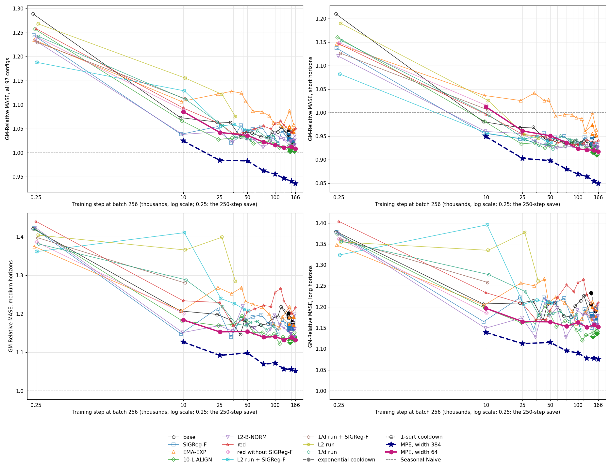
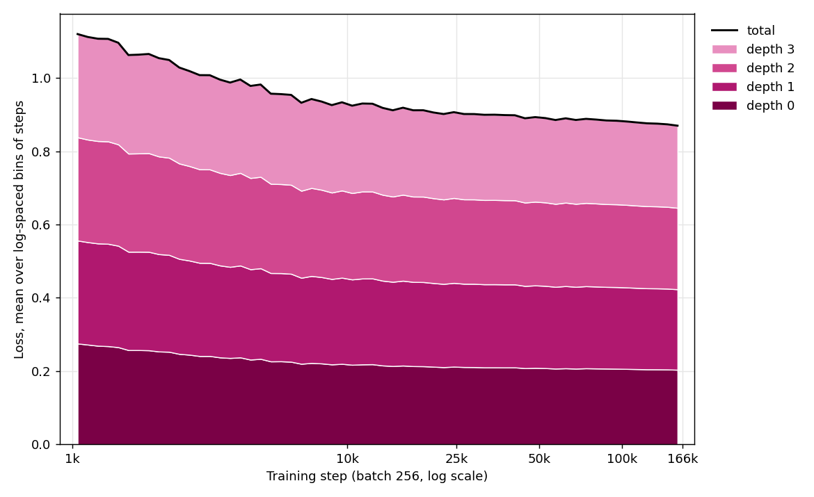

# Our copy of Moirai at the width-64 size on GIFT-Eval

One run (1 seed) of MPE, our copy of Moirai, at the width-64 size (width 64, 1 encoder layer, 3 forecaster layers) scores 0.053 to 0.073 GM-Relative MASE above MPE at width 384. At each of the 8 stops, this run is in the band of the 11 contrastive width-64 runs and their 10 cooldowns (1 seed each).

The total loss decreases from 1.12 to 0.87, and the 4 rollout depths keep almost equal parts of it.

| Stop | MPE, width 64 | MPE, width 384 | Difference |
|---|---|---|---|
| 10k | 1.0857 | 1.0247 | 0.0610 |
| 25k | 1.0422 | 0.9841 | 0.0581 |
| 50k | 1.0361 | 0.9831 | 0.0529 |
| 75k | 1.0221 | 0.9625 | 0.0596 |
| 100k | 1.0162 | 0.9555 | 0.0607 |
| 125k | 1.0106 | 0.9468 | 0.0638 |
| 150k | 1.0128 | 0.9405 | 0.0723 |
| 166k | 1.0090 | 0.9362 | 0.0728 |
